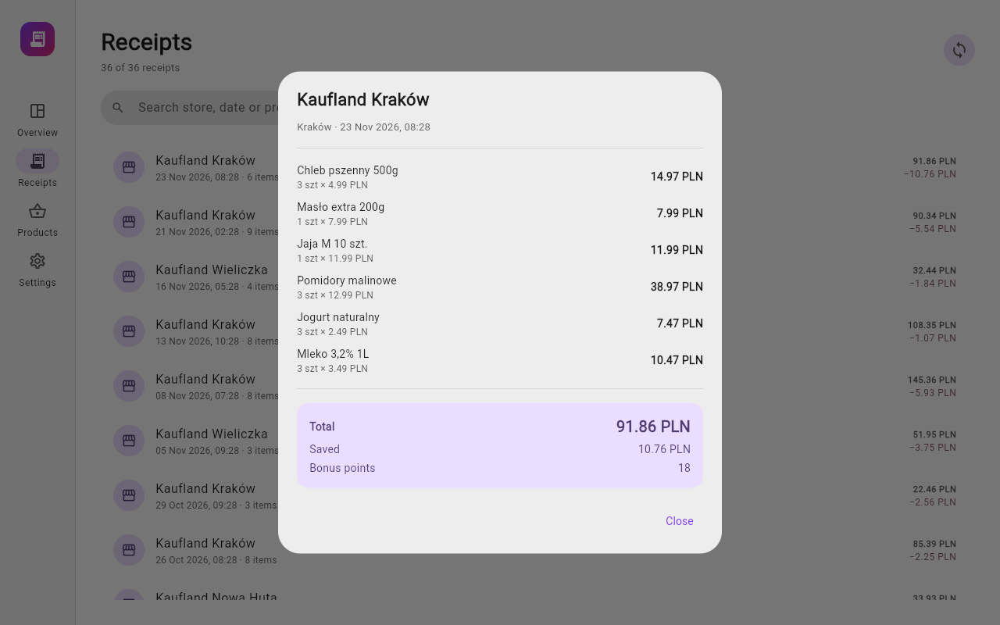
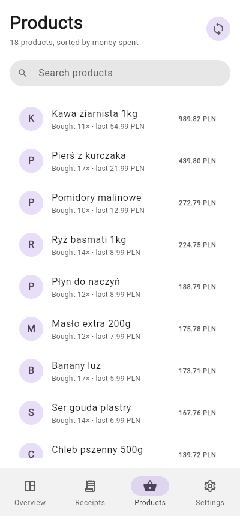
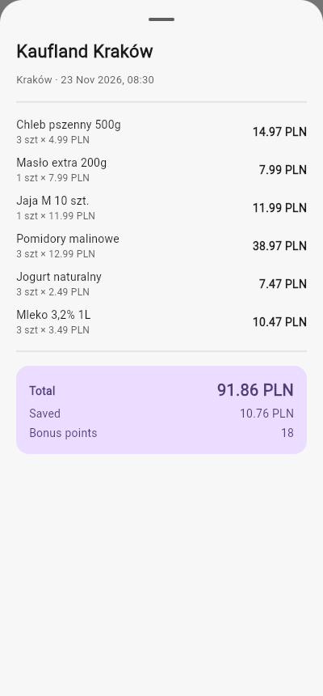

# kaufland-cli

Unofficial CLI for Kaufland Card digital receipts. It exports your purchase history as JSON or CSV: item names, quantities, prices and discounts, with no screenshots of the app.

<p>
  
  
</p>

## App for PC and Android

There is also a graphical app in [`gui/`](gui/) built with [Flet](https://flet.dev) (Python on Flutter). It reuses this package for login and fetching and adds:

- a dashboard with total spent and saved, average basket, monthly spending and top stores
- a searchable receipt list with itemised details
- a product view of everything you've bought, sorted by money spent
- CSV and JSON export, country picker, and light, dark or system theme
- a side rail on wide windows and a bottom bar on phones; one codebase for both
- demo data, so you can try the app without an account

| | | |
|---|---|---|
|  |  |  |

### Download

The [Build GUI apps](.github/workflows/gui.yml) workflow builds the Android APK and the Windows, Linux and macOS apps. Find them under the run's **Artifacts** in the Actions tab. When you push a `v*` tag, they are also attached to a GitHub release.

To install the APK, copy it to your phone, open it, and allow installs from that source. The APK is debug-signed. Android shows a warning because it does not come from the Play Store.

### Run from source

```sh
cd gui
uv run --with "flet[all]==1.1.3" flet run src/main.py
```

### Build locally

`flet build` downloads Flutter, plus the JDK and Android SDK for the APK, on first run.

```sh
cd gui
cp -r ../src/kaufland_cli src/
uv run --with "flet[all]==1.1.3" flet build apk      # or: windows, macos, linux
```

Output lands in `gui/build/<target>/`. The desktop apps need to be built on that OS.

The packaged app keeps its tokens and settings in its own app data folder, not in `~/.config/kaufland-cli`, so you sign in once inside the app.

## Install

```sh
uvx --from git+https://github.com/shinzo13/kaufland-cli kaufland --help
```

Or clone and run `uv run kaufland --help`.

## Use

```sh
kaufland login --email you@example.com   # once; password is prompted
kaufland list -n 10                      # one row per receipt
kaufland items -n 10 --output csv        # one row per purchased item
kaufland receipts --all                  # raw API payloads, full history
kaufland status
kaufland logout
```

## Config

| Variable | Default | Purpose |
|---|---|---|
| `KAUFLAND_COUNTRY` | `PL` | Two-letter country of your Kaufland account |
| `KAUFLAND_UI_LOCALES` | derived from country | Login page locale |
| `KAUFLAND_DATA_DIR` | `$XDG_CONFIG_HOME/kaufland-cli` | Token storage |
| `KAUFLAND_EMAIL` / `KAUFLAND_PASSWORD` | unset | Non-interactive login |
| `KAUFLAND_TIMEOUT_SECONDS` | `30` | HTTP timeout |

## Notes

- Auth is OAuth2 with PKCE against cidaas (`account.kaufland.com`) using the mobile client id. Receipts come from `p.crm-dynamics.schwarz/api/v2/customers/<sub>/transactions`.
- Login runs without a browser. The client accepts only the `com.kaufland.kaufland://` redirect, which no browser can follow, so credentials are posted straight to the cidaas login route.
- Tokens are stored in `tokens.json` with mode `0600` and refresh themselves, so `login` is needed only once. Your password is sent only to `account.kaufland.com`.
- Amounts arrive in minor units. `items` and `list` convert them, `receipts` does not.
- This is an app-facing API that can change without notice. Go easy on `--all`. Only receipts where the card was scanned at checkout exist in the history.
